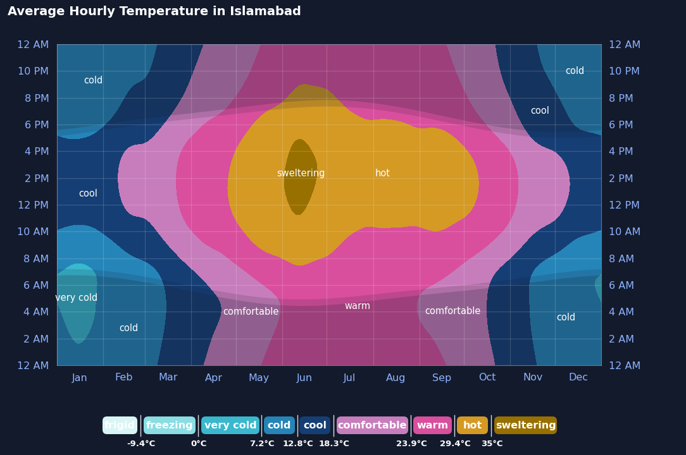

# 🌡️ Islamabad — Average Hourly Temperature (WeatherSpark-style)

A single-figure recreation of the classic **WeatherSpark "Average Hourly Temperature"**
chart, built for **Islamabad, Pakistan** (33.68°N, 73.04°E) from
[Open-Meteo Archive](https://open-meteo.com/) hourly data.



Each column is a day of the year, each row is an hour of the day. Colour encodes the
average 2 m air temperature, shaded so the daily and seasonal cycle are readable at a
glance. Dark bands mark night, lighter bands mark twilight — computed per-day from
NOAA solar equations, not hard-coded.

## How it works

**Data** — hourly `temperature_2m` for Islamabad from the Open-Meteo Archive API
(timezone `Asia/Karachi`). Hourly values are averaged across every year in the fetch
range, giving one 24 × 365 grid of "typical" values per (hour, day).

**Smoothing** — an anisotropic Gaussian filter (`scipy.ndimage.gaussian_filter`,
`sigma = (0.9 h, 6 days)`, `mode="wrap"`) removes day-to-day noise while preserving
the diurnal shape. The field is edge-padded and then up-sampled to pixel resolution
with a bicubic `RectBivariateSpline` so contour edges stay smooth.

**Comfort bands** — nine temperature bands with the usual thresholds:

| Band | Threshold (°C) |
|---|---|
| frigid | < −9.4 |
| freezing | −9.4 … 0 |
| very cold | 0 … 7.2 |
| cold | 7.2 … 12.8 |
| cool | 12.8 … 18.3 |
| comfortable | 18.3 … 23.9 |
| warm | 23.9 … 29.4 |
| hot | 29.4 … 35 |
| sweltering | > 35 |

**Day/night shading** — sunrise/sunset from the NOAA solar-position approximation
at a zenith of 90.833° (sunset) and 96° (civil twilight), plotted as translucent
dark overlays so the heat of the afternoon sits under a clear "day" column.

**Labels** — each colour band gets its name placed at the point inside the region
farthest from any edge, via a distance transform (`scipy.ndimage.distance_transform_edt`).
Regions thinner than `LABEL_MIN_RADIUS` are skipped.

**Legend** — the pill row along the bottom is drawn manually on an overlay axes so
the threshold labels (`0°C`, `7.2°C`, …) can sit precisely on the boundary between
pills.

## Outputs

- `islamabad_hourly_temperature.png` — the chart
- `islamabad_hourly_data.xlsx` — the raw hourly dataframe (`time`, `temp`)

## Run it

```bash
pip install -r requirements.txt
jupyter notebook Islamabad_Weather.ipynb
